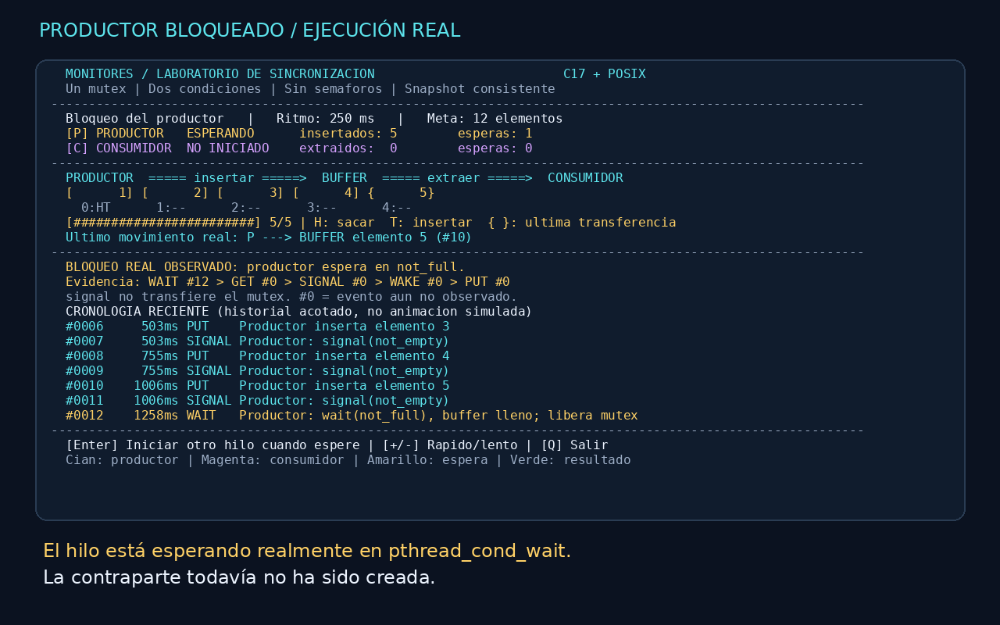
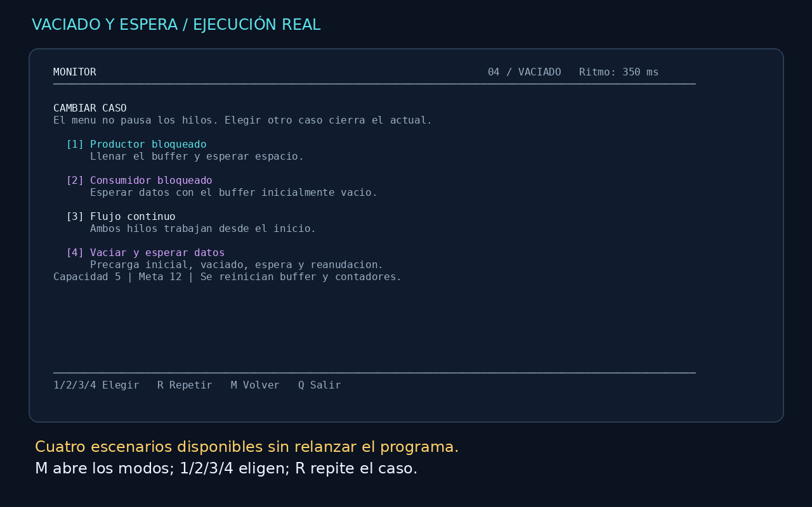

# Monitores · Laboratorio de sincronización

**Proyecto 7 — Sistemas Operativos. C17 + POSIX Threads, sin semáforos.**

Una terminal visual que muestra un productor y un consumidor, un búfer circular
FIFO y dos bloqueos reales: productor esperando espacio y consumidor esperando
datos. La interfaz observa el monitor; no simula la sincronización.



## Inicio rápido

Linux (desarrollado y probado en Ubuntu 26.04 LTS), GCC/Clang y GNU Make.
No requiere ncurses ni permisos de administrador para compilar.

```sh
make
./build/monitor-demo                          # demo guiada del productor
./build/monitor-demo --scenario consumer      # demo guiada del consumidor
./build/monitor-demo --scenario normal        # ambos hilos desde el inicio
```

En una terminal de al menos **80×24** (recomendado **110×34**):

- **Enter**: cuando se observe el bloqueo, iniciar al otro hilo.
- **D**: alternar entre vista visual y detalles técnicos.
- **+ / -**: aumentar/reducir velocidad (menos/más milisegundos entre operaciones).
- **Q**: cierre cooperativo, incluso durante una espera.
- **M**: abrir/cerrar el menú; **1 / 2 / 3 / 4** seleccionan productor, consumidor, flujo normal o vaciado.
- **R**: repetir el caso actual desde cero.
- **Enter al terminar**: abrir el menú para elegir otro caso; **Q** sale.
- `Ctrl+C`, `SIGTERM` y `SIGQUIT`: cerrar y restaurar la terminal.

Cian = productor; magenta = consumidor; amarillo = espera normal; verde = resultado.
Los estados tienen etiquetas, no dependen solo del color. `NO_COLOR` y
`--no-color` desactivan colores. Si tu entorno exporta `NO_COLOR`, ejecuta
`env -u NO_COLOR ./build/monitor-demo` para mostrar la paleta.

### Una vista limpia para la demo

Dos tarjetas muestran el estado y avance de los hilos. El centro presenta el
búfer con celdas grandes; la última transferencia se resalta en cian o magenta.
Una flecha marca el próximo elemento FIFO en el búfer circular. El flujo
productor → inserción → búfer → extracción → consumidor resalta transferencias reales.
Debajo aparecen la causa de espera y la evidencia histórica: **Esperó → Recibió señal → Continuó**.
Esta evidencia no es el estado actual; recibir una señal no implica continuar inmediatamente.
No hay párrafos explicativos ni cronología ocupando la pantalla principal.

**D** abre los detalles: índices `H`/`T`, contadores de esperas, secuencia numerada
y eventos recientes. D vuelve a la demo. Los detalles no pausan ni modifican los hilos.
`H` es la próxima extracción y `T` la próxima inserción; su igualdad puede significar
lleno o vacío, lo que se distingue con `count`.

Bordes redondeados en locales UTF-8; alternativa ASCII automática en otros locales.
Con muchos elementos y poco espacio, las celdas se compactan para mantener visibles
el estado y los controles. `--plain` conserva la traza completa en texto.

### Cambiar de caso sin reiniciar el programa

Pulsa **M**, luego **1** (bloqueo del productor), **2** (bloqueo del consumidor)
**3** (flujo normal) o **4** (vaciar y esperar datos). **R** repite el escenario actual. El menú **no pausa** los
hilos: al elegir, se cancela cooperativamente la ejecución anterior, se unen sus
hilos y se crea un monitor nuevo. Contadores y evidencia vuelven a cero.

Se conservan capacidad, ritmo y cantidad objetivo. Si el productor necesita más
elementos para demostrar lleno, el objetivo sube a `capacidad + 1`; el menú avisa.
Los casos seleccionados son guiados: Enter inicia la contraparte tras el bloqueo.
El flujo normal inicia ambos hilos. Solo se muestra **FIFO verificado** cuando
la validación de secuencia y los contadores confirman una ejecución correcta.



## Opciones

```sh
./build/monitor-demo --help
./build/monitor-demo --scenario producer --capacity 5 --items 12 --delay 400
./build/monitor-demo --scenario consumer --auto --delay 200
./build/monitor-demo --plain --scenario producer --capacity 2 --items 6 --delay 10
./build/monitor-demo --plain --scenario normal --capacity 1 --items 10000 --delay 0
```

| Opción | Valores | Defecto |
|---|---|---|
| `--scenario` | `producer`, `consumer`, `normal`, `drain` | `producer` |
| `--capacity` | 1–16 | 5 |
| `--items` | 1–1 000 000 | 20 |
| `--delay` | 0–2000 ms | 250 |
| `--auto` | Continúa automáticamente tras observar la espera | No |
| `--plain` | Traza sin control de pantalla | No |
| `--no-color` | Desactiva colores | No |

La demo `producer` requiere `items > capacity`. En tuberías, con `TERM=dumb`
o sin terminal interactiva, se usa texto y continuación automática. La demo
visual automática sostiene la espera 900 ms **después de observarla**, solo para
hacerla visible; esa demora no determina la corrección del monitor.

### Cómo interpretar la evidencia

```text
WAIT actor=P  -> GET actor=C -> SIGNAL actor=C -> WAKE actor=P -> PUT actor=P
WAIT actor=C  -> PUT actor=P -> SIGNAL actor=P -> WAKE actor=C -> GET actor=C
```

`WAKE` significa retorno de `pthread_cond_wait` con el mutex recuperado; **no**
garantiza por sí solo que el predicado permita operar. El `while` lo reevalúa.
`signal` no cede inmediatamente el mutex. `#0` en los detalles significa evento aún no
observado. Las cinco referencias se conservan después de la demo y se consultan con D.

El historial tiene 128 eventos: a velocidad máxima puede omitir eventos visuales.
El modo texto indica `GAP omitted=...`; esto no implica pérdida de elementos del
búfer. El consumidor verifica todos los valores FIFO independientemente del log.

```text
SUMMARY produced=20 consumed=20 remaining=0 waits_p=... waits_c=... status=OK
```

`CANCELLED` es una salida solicitada, no una ejecución completada. Q retorna 0;
señales retornan `128 + señal`; argumentos inválidos retornan 2 y fallos de
inicialización/integridad retornan 1. Una cancelación puede dejar datos pendientes.

## Pruebas

Se necesita Python 3 (solo biblioteca estándar) y `timeout` de GNU coreutils.

```sh
make check       # unitarias + integración/estrés + fallos de creación + PTY
make sanitize    # misma suite con AddressSanitizer + UndefinedBehaviorSanitizer
make tsan        # unitarias + 10000 elementos con ThreadSanitizer
```

Los sanitizadores se compilan por separado. LeakSanitizer no funciona bajo
`ptrace`: en entornos restringidos hay que ejecutar `make sanitize` fuera del
trazador; **no se desactiva** la comprobación de fugas para reportar un éxito.

Validaciones: FIFO, wraparound, capacidad 1, ambos wait/signal, cierre de hilos
bloqueados, argumentos inválidos, fallos en la primera/segunda creación de hilo,
160 000 transferencias de estrés por suite de integración, colores, controles,
redimensionamiento y restauración exacta de termios. CI ejecuta `make check` y
`make sanitize` en GitHub Actions; su resultado remoto debe consultarse en Actions.

## Arquitectura

```text
main/CLI ──> simulation ──> productor ──┐
                   └─────> consumidor ├──> Monitor privado (FIFO)
UI (hilo principal) ─── snapshot ──────┘     mutex + not_full + not_empty
```

- `src/monitor.c`: datos privados; todas las operaciones/snapshots bajo un mutex.
- `src/simulation.c`: hilos, verificación de orden, ritmo y cierre cooperativo.
- `src/ui.c`: ANSI + termios, teclado, colores y render solo en el hilo principal.
- `src/cli.c`: argumentos, mensajes y utilidades de tiempo.
- `src/main.c`: coordinación de demos, señales y limpieza.

El bloqueo por lleno/vacío siempre usa `pthread_cond_wait`; no hay sondeo activo
ni semáforos en el productor/consumidor. El refresco de la UI sí es periódico
(aprox. 30 Hz), con esperas de teclado. Los atómicos solo controlan parada, ritmo
e indicador de integridad; **no sustituyen** mutex/condiciones del búfer.

Al finalizar el productor se cierra el monitor y el consumidor drena lo pendiente.
Al cancelar se solicita detener ambos trabajadores. Cerrar hace `broadcast` en las
dos condiciones; durante el trabajo normal se usa `signal`. Se unen los hilos
antes de destruir las primitivas. Los errores de inicialización se devuelven y
limpian; un fallo interno inesperado de pthread provoca aborto explícito, nunca
continuación con datos sin protección. SIGKILL no permite limpieza.

## Entregables y exposición

- [Plan y criterios](docs/PLAN.md).
- [Guía de arquitectura y decisiones](docs/ARQUITECTURA.md).
- [Paper IEEE en PDF](docs/paper/main.pdf) y [fuente LaTeX](docs/paper/main.tex).
- [Presentación ejecutiva en PDF](docs/presentacion.pdf) y
  [versión interactiva](docs/presentacion.html): abrir en navegador; flechas
  izquierda/derecha o botones; imprimir a PDF con una diapositiva por página.
- [Video técnico subtitulado (MP4)](docs/media/demo-monitores.mp4), sin voz,
  con ejecuciones reales de ambos bloqueos.
- [Grabaciones originales y reproducción](docs/media/README.md).
- [Guion del video y preguntas de defensa](docs/DEMO.md).
- [Evidencias y límites de validación](docs/VALIDACION.md).

El equipo debe completar nombres, institución/docente y datos de entrega del
paper/presentación; revisar el material y preparar su defensa. No se inventan
integrantes, resultados experimentales ni aprobación del docente.

### Compilar el paper

Con una instalación LaTeX que incluya `IEEEtran` y español (`texlive-latex-extra`,
`texlive-publishers`, `texlive-lang-spanish` en Ubuntu):

```sh
cd docs/paper
pdflatex -interaction=nonstopmode main.tex
pdflatex -interaction=nonstopmode main.tex
```

No se requiere LaTeX para compilar o ejecutar el programa.

También se puede compilar con `tectonic docs/paper/main.tex` (Tectonic descarga
paquetes TeX y compila localmente; el PDF incluido se generó con Tectonic 0.17.0).

### Regenerar el video técnico

Solo para generar medios, se requieren Python + Pillow, FFmpeg y las fuentes
DejaVu. No son dependencias del programa C ni de `make check`.

```sh
make media
```

El script ejecuta el binario real en una pseudoterminal, conserva las grabaciones
`.cast`, genera capturas y codifica un MP4 con explicaciones en español. No tiene
narración de voz ni reemplaza la exposición del equipo.

### Caso 4: vaciar antes de bloquear

**M → 4** inicia con `capacity` elementos precargados como preparación, sin
hilos activos. El consumidor retira esos elementos en orden y, al intentar otra
extracción, espera en `not_empty`. **Enter** inicia el productor con el siguiente
ID; su inserción y señal permiten reanudar al consumidor. R repite el caso.

```sh
./build/monitor-demo --scenario drain --capacity 5 --items 12 --delay 350
```

`--items` cuenta todos los elementos, incluida la precarga, y debe superar la
capacidad en `drain`. Desde el menú se ajusta automáticamente si hace falta.
La UI identifica la preparación; los contadores incluyen esos elementos iniciales.
Usar un ritmo de 200–500 ms permite observar el vaciado; a ritmo cero puede pasar
entre dos frames, pero la traza conserva las extracciones anteriores a WAIT.

Entorno confirmado en `/etc/os-release`: **Ubuntu 26.04 LTS (Resolute Raccoon)**.
